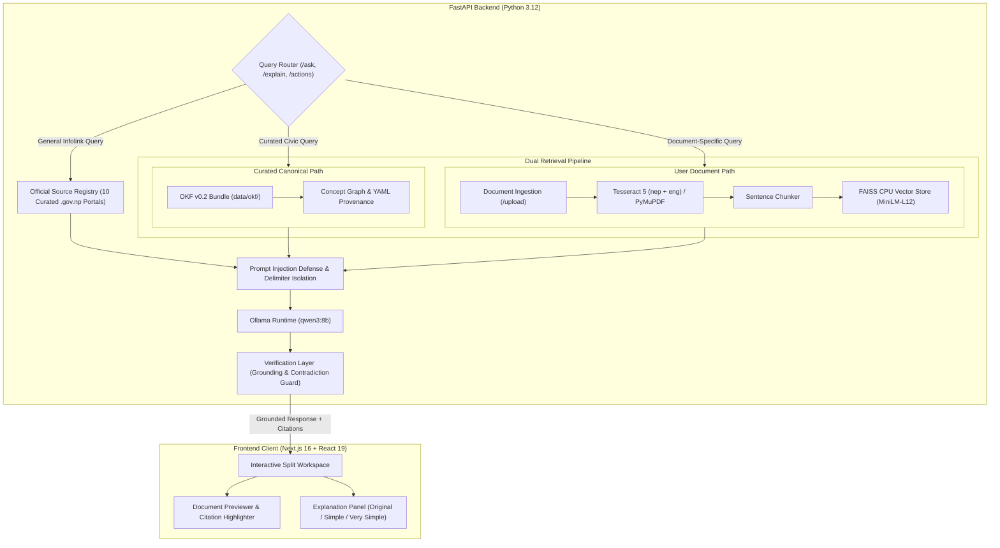

# hamiGenZ — Nepal-Focused AI Document Understanding & Grounded Knowledge Platform

> A privacy-conscious, evidence-grounded AI platform engineered to make complex Nepali administrative notices, civil documents, and government procedures accessible. Built on the **Open Knowledge Format (OKF v0.2)**, offline multilingual vector embeddings, Devanagari OCR, and a multi-stage verification layer designed to provide verifiable provenance, evidence-grounded citations, and hallucination reduction guardrails.

[](https://hami-genz.vercel.app/)
[](https://github.com/omwe77/hamiGenz)
[](LICENSE)
[](https://python.org)
[](https://fastapi.tiangolo.com)
[](https://nextjs.org)
[-orange?style=for-the-badge)](https://ollama.ai)
[](https://huggingface.co/sentence-transformers/paraphrase-multilingual-MiniLM-L12-v2)

---

> [!NOTE]
> ### 🌐 Portfolio Demo Disclosure
> The public deployment at [hami-genz.vercel.app](https://hami-genz.vercel.app/) is a **client-side portfolio demonstration** hosted on Vercel.
> - **Predefined Sample Mode:** The live web demo showcases full UI interactions, the split-screen document workspace, dynamic citation highlighting, action checklist extraction, and the continuous scroll-driven provenance thread using pre-computed sample responses.
> - **Illustrative Sample Data Warning:** All sample notices, extracted form fields, fees, and deadlines in the public demo are **illustrative fixtures** provided for interface demonstration. Unless independently verified against current official government sources, sample data must not be relied upon for real civic, administrative, or legal applications.
> - **Live AI Backend:** Real-time processing of arbitrary user uploads, Tesseract OCR, dynamic vector indexing, and local LLM inference require a locally hosted or cloud-hosted instance of the FastAPI backend connected to an [Ollama](https://ollama.ai) instance (`qwen3:8b`). Follow the [Quick Start](#7-quick-start--local-development) instructions below to run the complete end-to-end stack locally.

---

## Table of Contents

1. [Problem & Context: Why hamiGenZ Matters in Nepal](#1-problem--context-why-hamigenz-matters-in-nepal)
2. [Dual Retrieval Architecture: OKF v0.2 vs Conventional RAG](#2-dual-retrieval-architecture-okf-v02-vs-conventional-rag)
3. [End-to-End System Architecture](#3-end-to-end-system-architecture)
4. [Key Features & Capabilities](#4-key-features--capabilities)
5. [Technology Stack](#5-technology-stack)
6. [Repository Layout](#6-repository-layout)
7. [Quick Start & Local Development](#7-quick-start--local-development)
8. [Configuration & Environment Variables](#8-configuration--environment-variables)
9. [Evaluation & Benchmark Results](#9-evaluation--benchmark-results)
10. [Known Limitations & Operational Boundaries](#10-known-limitations--operational-boundaries)
11. [License & Attribution](#11-license--attribution)

---

## 1. Problem & Context: Why hamiGenZ Matters in Nepal

Navigating civil and public administration in Nepal presents severe cognitive, linguistic, and operational hurdles for citizens:

- **Bureaucratic & Administrative Fragmentation:** Guidelines for essential civil documents (Citizenship Certificates, Machine Readable Passports/e-Passports, National Identity Cards (NID), and Voter Registrations) are dispersed across disparate legal gazettes, complex municipal circulars, and low-contrast scanned PDFs.
- **Multilingual & Multi-Script Confusion:** Official public notices frequently mix archaic legal Devanagari, English technical jargon, and colloquial Romanized Nepali. Citizens often struggle to translate official terms into actionable steps.
- **The Pitfall of General-Purpose Cloud LLMs:** Standard cloud LLMs routinely hallucinate obsolete fees, invent nonexistent consular rules, lack awareness of Bikram Sambat (B.S.) date formats, and fail on low-resolution Devanagari scans.
- **Privacy & Sovereignty Concerns:** Citizens should never be required to upload sensitive personal identification documents (such as citizenship certificates or birth records) to commercial, third-party cloud AI vendors.

**hamiGenZ** solves this challenge with a **local-first, grounded document-understanding platform**. It ingests citizen documents, extracts bilingual text using OCR with Devanagari character-density detection, routes inquiries against an authoritative curated knowledge base (OKF v0.2), and generates multi-tier simplified explanations backed by verifiable, interactive citations.

---

## 2. Dual Retrieval Architecture: OKF v0.2 vs Conventional RAG

Standard Retrieval-Augmented Generation (RAG) relies on blindly slicing documents into arbitrary character chunks, embedding them, and retrieving the top-$k$ nearest neighbors via cosine similarity. In civic and legal domains, this introduces fatal flaws:
- Context is fractured across chunk boundaries (e.g., fee exceptions separated from base fee schedules).
- Outdated or conflicting public circulars are statistically retrieved if vocabulary matches.
- There is no concept graph or typed hierarchy among prerequisite documents.

hamiGenZ implements a **Dual-Path Retrieval Architecture**:

```
┌────────────────────────────────────────────────────────────────────────┐
│             Why OKF v0.2 Outperforms Conventional Naive RAG           │
├───────────────────────────────────┬────────────────────────────────────┤
│ Standard Chunk-Based RAG          │ Open Knowledge Format (OKF v0.2)   │
├───────────────────────────────────┼────────────────────────────────────┤
│ Statistical chunk similarity      │ Canonical, curated concept graphs  │
│ Context lost across split chunks  │ Durable frontmatter & provenance   │
│ Blind retrieval of outdated info  │ Versioned trust tiers & validation │
│ No relationship awareness         │ Bounded graph link traversal       │
│ Vulnerable to chunk boundaries    │ Self-contained atomic entities     │
└───────────────────────────────────┴────────────────────────────────────┘
```

1. **Curated Canonical Knowledge (OKF v0.2):**
   - Located under `data/okf/`, official civic procedures are stored as versioned Markdown concept files with structured YAML frontmatter.
   - Files define explicit concept types (`DocumentType`, `FormGuide`, `OCRRule`, `FieldDefinition`), authoritative sources (`verified: {by, at}`), and explicit graph links (`links`).
   - The query router traverses typed links up to a bounded depth to construct deterministic, cohesive context packages.
   - Validated at build time via `backend/okf_validator.py`.

2. **Uploaded Document Retrieval (Multilingual FAISS Vector Store):**
   - User-uploaded PDFs and scans are chunked with structural awareness and indexed into per-document FAISS CPU indices.
   - Vectorized using `sentence-transformers/paraphrase-multilingual-MiniLM-L12-v2` (384-dimensional dense vectors), specifically evaluated for high cross-lingual transfer between English and Devanagari Nepali.
   - Index headers include an embedding model stamp to prevent silent vector space corruption.

---

## 3. End-to-End System Architecture



### In-Depth Pipeline Walkthrough

1. **Document Ingestion & OCR:** Digital PDFs are processed directly via `pdfplumber` and `PyMuPDF`. Scanned images and raster PDFs are analyzed with Tesseract 5.x. An automatic script detector analyzes Devanagari character density to dynamically switch between Nepali-primary (`nep`) and bilingual (`nep+eng`) recognition modes.
2. **Security & Prompt Defense (`backend/prompt_guard.py`):** Before constructing prompt context, untrusted text is sanitized: zero-width unicode smuggling characters and role-hijacking tokens are stripped. All retrieved passages are isolated inside strict `<evidence>` delimiters with non-override instructions.
3. **Local Inference:** When running in the local self-hosted configuration, queries and isolated evidence are dispatched to a local Ollama server running `qwen3:8b` (4-bit quantized, ~4.5 GB footprint) on `127.0.0.1:11434`. In this self-hosted environment, inference requests and document payloads are processed locally on local resources without transmitting data to external third-party cloud AI vendors.
4. **Verification & Grounding (`backend/verification.py`):** A secondary deterministic check inspects the model's generated claims against the retrieved evidence text. If key facts lack explicit provenance or if negation states are inverted, the response is rejected or flagged: *"I could not verify this from an authoritative source."* Automated verification mitigates ungrounded assertions but does not guarantee complete correctness.
5. **Interactive UI Rendering:** The Next.js frontend highlights corresponding text citations directly on the document canvas when a user clicks on an explanation citation tag.

---

## 4. Key Features & Capabilities

- 📄 **Interactive Split-Screen Workspace:** Left panel renders the active PDF or image with bounding citations; right panel renders multi-tier explanations with interactive verification cards.
- 🎚️ **Multi-Tier Simplification:** Read documents at three distinct cognitive levels:
  - **Original:** Exact, unabridged legal/administrative text.
  - **Simple:** Plain-language summary removing bureaucratic legalese.
  - **Very Simple:** Bulleted breakdown with step-by-step guidance tailored for accessibility.
- ✅ **Action Extraction & Form Checklists (`/actions`):** Automatically extracts required documents, deadlines, fees (with Devanagari and Arabic numeral normalization), eligibility rules, and official `.gov.np` portals.
- 🏛️ **Official Source Registry (`/knowledge/sources`):** Curated directory of 10 verified Nepali government institutions (Passport Department, National ID & Civil Registration, Immigration, Supreme Court, Inland Revenue, etc.) with verified domain boundaries.
- 🔒 **Local-First Architecture:** Built for self-hosted deployment where document ingestion, OCR, FAISS vector indexing, and Ollama inference run on local system resources. In a local setup, documents and vector indices remain stored on the local disk (`backend/data/`).
- 🎨 **Full-Page Provenance Animation:** Scroll-driven continuous SVG provenance thread built with React 19, native SVG cubic Bézier splines, dynamic anchor measurement via `ResizeObserver`, and scroll synchronization via `requestAnimationFrame`. Illustrates the sequence of custody from document intake to grounded verification.

---

## 5. Technology Stack

### Frontend
- **Framework:** Next.js 16.3 (App Router, Turbopack)
- **UI Library:** React 19, TypeScript
- **Styling:** Vanilla CSS with design token variables (glassmorphism, dark civic aesthetic)
- **Animation & Motion:** Native SVG cubic Bézier curves, requestAnimationFrame scroll-tracking, CSS keyframe transitions (Anime.js installed for scripted sequences)
- **Icons:** Custom inline SVG iconography (zero external icon library dependencies)

### Backend
- **Framework:** FastAPI 0.115+, Uvicorn, Pydantic v2
- **Language:** Python 3.12+
- **OCR Engine:** Tesseract OCR 5.x (`nep` and `eng` traineddata), PyMuPDF (`fitz`), pdfplumber
- **Embeddings & Vector Store:** `sentence-transformers` (`paraphrase-multilingual-MiniLM-L12-v2`), FAISS (CPU)
- **Inference Runtime:** [Ollama](https://ollama.ai) (`qwen3:8b`)
- **Knowledge Format:** Open Knowledge Format (OKF v0.2) specification

---

## 6. Repository Layout

```
hamiGenz/
├── backend/                  # FastAPI Application & Core Engines
│   ├── main.py               # REST API endpoints (20 routes)
│   ├── okf_bundle.py         # OKF v0.2 parser, loader & graph router
│   ├── okf_validator.py      # Conformance & schema checker for OKF
│   ├── pipeline.py           # Ingestion, chunking, and document workflow
│   ├── ocr.py                # Dual-engine Tesseract & PyMuPDF extractor
│   ├── vector_store.py       # FAISS dense index with model checksum guard
│   ├── prompt_guard.py       # Injection sanitizer & evidence delimiter guard
│   ├── verification.py       # Post-generation grounding & contradiction filter
│   ├── action_extractor.py   # Fee, deadline, and checklist extractor
│   ├── source_registry.py    # Curated official Nepali government sources
│   └── form_preview.py       # Form field detection & coordinate overlay
├── data/
│   ├── okf/                  # Curated OKF v0.2 concept files & graphs
│   └── uploads/              # Local uploaded document storage (gitignored)
├── docs/                     # Architectural, deployment, and benchmark documentation
│   ├── DEPLOYMENT.md         # Production deployment & self-hosting guide
│   ├── DEPLOYMENT_PLAN.md    # Staging reference plan (historical Azure design)
│   └── EVALUATION.md         # Retrieval benchmarks & gold evaluation results
├── frontend/                 # Next.js 16 + React 19 Frontend Application
│   ├── src/
│   │   ├── app/              # App router (homepage, workspace, layout)
│   │   ├── components/       # UI components (workspace, motion, forms)
│   │   └── lib/              # API clients, sample offline fixtures, mock state
│   └── public/               # Static icons, sample documents, blank forms
├── tests/                    # Backend automated test suite
│   ├── evaluation/           # Gold dataset (17 cases) & retrieval benchmarks
│   ├── test_actions.py       # Checklist & action extraction tests
│   ├── test_forms.py         # Form field detection tests
│   ├── test_okf.py           # OKF bundle loading & graph tests
│   ├── test_pipeline.py      # End-to-end ingestion tests
│   ├── test_prompt_guard.py  # Security & sanitization tests
│   └── test_security.py      # Path traversal & delimiter tests
├── CHANGELOG.md              # Project version history
├── LICENSE                   # MIT License
└── README.md                 # Project documentation
```

---

## 7. Quick Start & Local Development

### Prerequisites

1. **Python:** 3.12 or higher
2. **Node.js:** 20.9+ (Next.js 16 requirement)
3. **Ollama:** Installed and running locally. Pull the target model:
   ```bash
   ollama pull qwen3:8b
   ```
4. **Tesseract OCR:** Installed with both English and Nepali language packs:
   - **Ubuntu/Debian:** `sudo apt install tesseract-ocr tesseract-ocr-nep tesseract-ocr-eng`
   - **macOS (Homebrew):** `brew install tesseract tesseract-lang`
   - **Windows:** Install via [UB-Mannheim installer](https://github.com/UB-Mannheim/tesseract/wiki), ensuring `Nepali` language data is selected during setup.

---

### Step 1: Set Up and Run the Backend

```bash
# Clone the repository
git clone https://github.com/omwe77/hamiGenz.git
cd hamiGenz

# Create and activate a Python virtual environment
python -m venv .venv

# On Linux/macOS:
source .venv/bin/activate
# On Windows (PowerShell):
.venv\Scripts\Activate.ps1

# Install backend dependencies
pip install -r requirements.txt

# Start the FastAPI server (reloads on file changes)
uvicorn backend.main:app --host 127.0.0.1 --port 8000 --reload
```

The FastAPI OpenAPI documentation will be accessible at `http://127.0.0.1:8000/docs`.

---

### Step 2: Set Up and Run the Frontend

In a separate terminal window:

```bash
cd frontend

# Install npm dependencies
npm install

# Start Next.js development server
npm run dev
```

Open `http://localhost:3000` in your browser. The application will connect directly to your local FastAPI backend. If the backend is not running, the frontend gracefully falls back to interactive Demo Mode.

---

### Step 3: Run Automated Verification Tests

Verify the entire system using the built-in test suites:

```bash
# 1. Run the backend unit and integration test suite
python -m pytest tests/test_actions.py tests/test_forms.py tests/test_security.py tests/test_source_registry.py tests/test_prompt_guard.py tests/test_pipeline.py tests/test_okf.py -q

# 2. Validate the OKF v0.2 knowledge bundle conformance
python -m backend.okf_validator

# 3. Run the offline evaluation self-consistency mock
python -m tests.evaluation.eval_explanations

# 4. In frontend/: run automated offline client checks and Next.js build
cd frontend
npm run test
npm run build
```

---

## 8. Configuration & Environment Variables

Create a `.env` file in the repository root for backend configuration:

```env
# Ollama LLM Runtime
OLLAMA_BASE_URL=http://localhost:11434
OLLAMA_MODEL=qwen3:8b

# Multilingual Embeddings & Vector Store
EMBED_MODEL=paraphrase-multilingual-MiniLM-L12-v2
REINDEX_ON_STARTUP=1

# CORS & Frontend Origins
FRONTEND_ORIGIN=http://localhost:3000
CORS_EXTRA_ORIGINS=https://hami-genz.vercel.app

# Local Storage (Managed under backend/data/)
# backend/data/hamigenz.db (Metadata SQLite)
# backend/data/uploads/    (Uploaded PDFs and scans)
# backend/data/vectors/    (FAISS indices and model stamps)
```

For the frontend, configure `frontend/.env.local` if your backend runs on a custom host:

```env
# Frontend environment
NEXT_PUBLIC_API_BASE_URL=http://127.0.0.1:8000
```

---

## 9. Evaluation & Benchmark Results

hamiGenZ is rigorously evaluated against a **human-verified gold dataset** (`tests/evaluation/gold_dataset.py`) consisting of 17 real-world test cases covering formal Nepali, statutory clauses, conditional fee waivers, Bikram Sambat date conversions, and mixed-script text.

Detailed evaluation methodology and full logs are available in [docs/EVALUATION.md](docs/EVALUATION.md).

### Retrieval Benchmark (Cross-Lingual & Multi-Script)

Evaluated across 18 realistic queries in 4 linguistic styles against a synthetic government corpus:

| Query Linguistic Style | all-MiniLM-L6-v2 (Hit@1) | paraphrase-multilingual-MiniLM-L12-v2 (Hit@1) | MRR (New Default) |
|---|:---:|:---:|:---:|
| **English (over Nepali docs)** | 0.00 | **1.00** | 1.00 |
| **Nepali Script (Devanagari)** | 0.40 | **1.00** | 1.00 |
| **Romanized Nepali** | 0.25 | **0.50** | 0.61 |
| **Mixed Script** | 0.25 | **0.25** | 0.53 |
| **Overall Mean** | 0.22 | **0.72** | **0.81** |
| **Negative Probe False-Match Rate** | 0.33 | **0.00** | — |

### Explanation Quality Benchmark (Live qwen3:8b on Gold Dataset)

| Metric | Measured Score | Benchmark Scope & Definition |
|---|:---:|---|
| **Key Fact Preservation** | **88.2% (15/17)** | Deterministic preservation of benchmark dates, fees, and requirements. |
| **Negation & Forbidden Fact Accuracy** | **100% (17/17)** | Measured strictly within the 17-case gold dataset via deterministic negation and forbidden-fact checks; does not guarantee zero hallucinations on arbitrary real-world queries. |
| **Script Appropriateness** | **100% (17/17)** | Accurate Devanagari output for Nepali inquiries without English leakage. |
| **Overall Benchmark Pass Rate** | **88.2% (15/17)** | Verified against deterministic gold assertions without stochastic LLM-judge bias. |

> [!WARNING]
> **Evaluation Scope & Real-World Behavior**
> The 100% negation and forbidden fact accuracy reflects the measured result solely on the specific 17-case gold benchmark (`tests/evaluation/gold_dataset.py`). **This benchmark result does NOT guarantee zero hallucinations, factual correctness, or absence of errors in real-world or production usage.** Like all large language model systems, the underlying model can omit nuance, misinterpret ambiguous colloquial text, or produce ungrounded assertions when exposed to complex, unseen, or degraded real-world documents.

---

## 10. Known Limitations & Operational Boundaries

- **Illustrative Public Sample Data:** Pre-loaded sample documents (such as `registration_form_sample.pdf`) and demo responses are illustrative fixtures designed for interface exploration. Citizens and applicants must not rely on sample fees, processing times, or documentation requirements for real administrative applications; always consult the appropriate issuing authority.
- **No Guarantee of Absolute Accuracy:** While the verification layer flags ungrounded assertions and contradictory claims against retrieved passages, automated verification is a mitigation rather than an absolute guarantee. Model outputs must be independently verified by the applicant with the relevant government department.
- **Compute Hardware Requirements:** Running `qwen3:8b` via Ollama requires at least 8 GB of unified RAM / VRAM. On lower-spec hardware, token generation latency will increase.
- **Severely Degraded Physical Scans:** While Tesseract with custom Devanagari models performs well on standard scans, heavily crumpled, torn, or low-contrast mobile snapshots may reduce extraction confidence. The system explicitly alerts the user when OCR confidence falls below 60%.
- **Romanized Query Challenges:** Cross-lingual retrieval on unstandardized Romanized Nepali (e.g. *"nagarikta banauna k k chaincha"*) scores 0.50 Hit@1. Standardizing colloquial phonetic variants remains an ongoing area of research.
- **Informational Purpose Only:** hamiGenZ is an educational and civic clarification assistant. It is **not** an official legal authority, judicial counselor, or statutory authority. Critical administrative proceedings should always be confirmed with the official issuing government department.

---

## 11. License & Attribution

- **License:** Distributed under the [MIT License](LICENSE). Copyright © 2026 Om Dangol.
- **Knowledge Architecture:** Built in conformance with the Open Knowledge Format (OKF v0.2) specification.
- **Community & Contributions:** Issues and feature discussions are welcomed via [GitHub Issues](https://github.com/omwe77/hamiGenz/issues).
