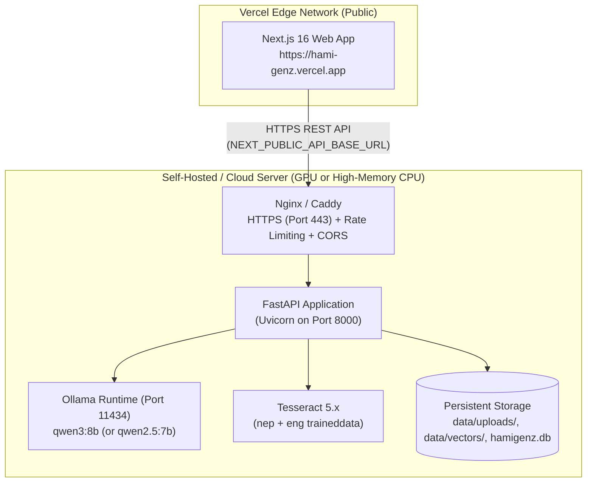

# hamiGenZ — Deployment Architecture & Operations Guide

This guide documents the actual production deployment architecture of **hamiGenZ**, the configuration of its public demo on Vercel, and the prerequisites and operational requirements for connecting a live self-hosted FastAPI and Ollama backend.

---

## 1. Current Production Deployment: Vercel Public Demo

The public web client for hamiGenZ is deployed on **Vercel**:
- **Production URL**: [https://hami-genz.vercel.app/](https://hami-genz.vercel.app/)
- **Hosting Environment**: Vercel Serverless / Edge Network (Next.js 16 SSG & App Router)
- **Deployment Status**: **Live (Offline Demo Mode)**

### Demo-Only Operating Model

Because hamiGenZ is designed as a local-first civic AI platform that requires an 8-billion-parameter local model (`qwen3:8b`), local Devanagari OCR (`tesseract-ocr` with `nep.traineddata`), and local vector indices (`faiss-cpu`), the public Vercel deployment operates intentionally in **Offline Demo Mode**:
- **Predefined Sample Data**: Demonstrations run on human-verified civic notices (such as `registration_form_sample.pdf`).
- **Zero Localhost Leaks**: The client checks `hasLiveBackend()` and does not attempt network calls to `localhost` or `127.0.0.1` on public hostnames.
- **In-Browser Upload Safety**: Files uploaded in Demo Mode are processed strictly inside local browser memory; no documents or identity data are transmitted to any remote server.
- **Disclosures**: Clear notices on both the landing page and the workspace inform visitors that live AI inference requires a connected private or local backend.

---

## 2. Live Backend Architecture & Deployment Requirements

Running live OCR, embedding generation, and grounded LLM inference in production requires deploying the Python FastAPI backend to an infrastructure provider that satisfies several hard technical requirements.



### Operational Requirements

| Component | Minimum Specification | Why It Is Required |
|---|---|---|
| **RAM / VRAM** | 8 GiB Unified Memory (16 GiB recommended) | `qwen3:8b` (Q4_K_M quantization) requires ~4.5 GiB; sentence-transformers, FAISS, PyMuPDF, and the operating system require the remaining headroom. |
| **Compute** | 4+ vCPU or dedicated NVIDIA GPU (CUDA) | CPU inference on 8B models takes 5–15 seconds per response; GPU inference reduces latency to < 1.5 seconds. |
| **Persistent Storage** | Persistent Volume / Block Storage (≥ 20 GiB) | Uploaded documents (`backend/data/uploads/`), FAISS index files (`backend/data/vectors/`), and the SQLite registry database (`backend/data/hamigenz.db`) must persist across restarts. Ephemeral containers will lose all uploaded state on redeployment. |
| **System Dependencies** | Ubuntu 22.04/24.04 LTS or Debian 12 | Requires `tesseract-ocr`, `tesseract-ocr-nep`, `tesseract-ocr-eng`, `poppler-utils`, and `python3.12`. |
| **TLS / HTTPS** | Valid SSL/TLS Certificate (e.g., Let's Encrypt) | Browsers enforce mixed-content blocking. Because the frontend is served over HTTPS from Vercel, the backend API endpoint **must** use valid HTTPS. |
| **CORS Allowlist** | Strict Origin Configuration | Backend `FRONTEND_ORIGIN` must allow `https://hami-genz.vercel.app` (and any custom staging domains) while blocking arbitrary origins. |

---

## 3. Step-by-Step Self-Hosted Backend Deployment

### 1. System Package Provisioning (Ubuntu Example)

```bash
# Update and install base utilities
sudo apt update && sudo apt upgrade -y
sudo apt install -y python3.12 python3.12-venv python3-pip git nginx tesseract-ocr tesseract-ocr-nep tesseract-ocr-eng

# Install Ollama
curl -fsSL https://ollama.com/install.sh | sh

# Pull the verified civic generation model
ollama pull qwen3:8b
```

### 2. Application Installation

```bash
# Clone repository to deployment directory
sudo mkdir -p /opt/hamigenz
sudo chown $USER:$USER /opt/hamigenz
git clone https://github.com/omwe77/hamiGenz.git /opt/hamigenz
cd /opt/hamigenz

# Create and activate Python virtual environment
python3.12 -m venv .venv
source .venv/bin/activate

# Install dependencies
pip install -r requirements.txt
```

### 3. Environment Configuration

Create `/etc/hamigenz.env`:

```env
OLLAMA_BASE_URL=http://localhost:11434
OLLAMA_MODEL=qwen3:8b
EMBED_MODEL=paraphrase-multilingual-MiniLM-L12-v2
REINDEX_ON_STARTUP=1
FRONTEND_ORIGIN=https://hami-genz.vercel.app
CORS_EXTRA_ORIGINS=http://localhost:3000
```

### 4. Systemd Service Setup

Create `/etc/systemd/system/hamigenz-api.service`:

```ini
[Unit]
Description=hamiGenZ FastAPI Backend Service
After=network.target ollama.service

[Service]
Type=simple
User=www-data
Group=www-data
WorkingDirectory=/opt/hamigenz
EnvironmentFile=/etc/hamigenz.env
ExecStart=/opt/hamigenz/.venv/bin/uvicorn backend.main:app --host 127.0.0.1 --port 8000 --workers 2
Restart=always
RestartSec=5

[Install]
WantedBy=multi-user.target
```

Enable and start services:
```bash
sudo systemctl daemon-reload
sudo systemctl enable --now ollama
sudo systemctl enable --now hamigenz-api
```

### 5. Reverse Proxy Configuration (Nginx)

Configure Nginx to terminate SSL and proxy requests to Uvicorn:

```nginx
server {
    listen 80;
    server_name api.yourdomain.org;
    return 301 https://$host$request_uri;
}

server {
    listen 443 ssl http2;
    server_name api.yourdomain.org;

    ssl_certificate /etc/letsencrypt/live/api.yourdomain.org/fullchain.pem;
    ssl_certificate_key /etc/letsencrypt/live/api.yourdomain.org/privkey.pem;

    client_max_body_size 50M;

    location / {
        proxy_pass http://127.0.0.1:8000;
        proxy_set_header Host $host;
        proxy_set_header X-Real-IP $remote_addr;
        proxy_set_header X-Forwarded-For $proxy_add_x_forwarded_for;
        proxy_set_header X-Forwarded-Proto $scheme;
        proxy_read_timeout 90s;
    }
}
```

---

## 4. Connecting Vercel to Your Live Backend

Once your backend is running behind HTTPS:
1. Navigate to your project on the **Vercel Dashboard**.
2. Go to **Settings** → **Environment Variables**.
3. Set `NEXT_PUBLIC_API_BASE_URL` to `https://api.yourdomain.org`.
4. Trigger a redeployment.
5. The workspace will now recognize the live backend and enable live document OCR, dynamic FAISS indexing, and real-time query answering.

---

## 5. Security & Isolation Checklist

- [ ] **Ollama Port Restricted**: Port `11434` must **never** be exposed to public networks. Only localhost communication with the FastAPI process is permitted.
- [ ] **Rate Limiting**: Nginx or API middleware limits uploads and query endpoints to prevent denial-of-service on local GPU/CPU inference.
- [ ] **File Size Bounds**: Uploads capped at 50 MB with magic-byte PDF/image validation and UUID-isolated disk storage.
- [ ] **Prompt Injection Isolation**: Document chunks wrapped in `<evidence>` delimiters before LLM evaluation.
- [ ] **CORS Bounds**: Backend only accepts requests from configured frontend origins.
